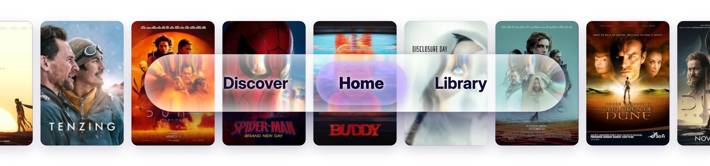
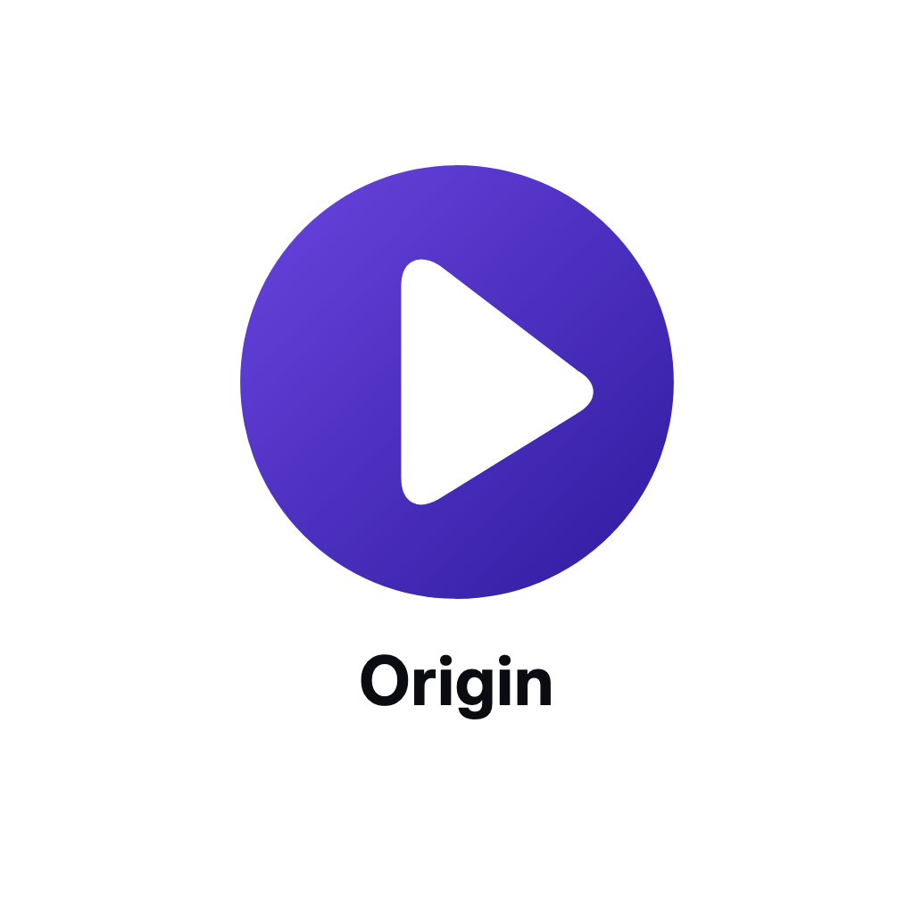
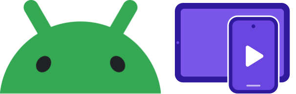

  
  &nbsp;&nbsp;&nbsp;&nbsp;
  

<h1 align="center">Stremio Origin for Android phones and tablets</h1>

A native app for Stremio addons, written in C.

<em>Stremio™ is a trademark of its owner. Stremio Origin is independent and unofficial, and is not affiliated with, endorsed by or sponsored by Stremio. Android is a trademark of its owner; its logo only shows which platform this is for.</em>

You bring your own Stremio account and your own addons. The app ships empty and plays only the stream links your addons return.

## Features
- Seek previews: a picture of the film on the seek bar, for debrid, direct and torrent links
- Trakt: link with a code, scrobbling, rows on Home, watched marks and Continue Watching from Trakt
- Home, Discover, Library and Search, with the addons from your Stremio account
- Film collections in order, in the Library too, and the next film after the credits
- Live TV and sports from your addons, with All channels, Favorites, Recent and a preview as you browse
- The best stream picked in one press, and a sources tray with a tab for each addon
- Styled subtitles as the film made them, with fonts (Arabic too), size, colour, position, brightness and sync
- Forced-only subtitles; each show remembers its subtitles and audio, original language by default
- Skip intro and recap, and at the credits a choice of watching them or starting the next episode
- Auto-play next episode, and playback speed from 0.5× to 2×
- Spoilers blurred for episodes you haven't watched, and upcoming episodes on Home
- A viewer notice as a film starts: an age and its reasons, from IMDb's Parents Guide
- A row for every catalog, with artwork, logos, trailers, people, reviews and ratings
- Titles and descriptions in your language
- Library, watched state and Continue Watching synced with your Stremio account
- Accent colour, taken from the artwork or the logo
- Downloads to watch offline: torrents and direct links, a whole season or collection at once, kept in the app, a folder or on an SD card
- Watch a download while it is still downloading, torrent or direct link
- Cast to a TV running Stremio Origin: the TV plays and the phone is the full remote, with play, pause and seek, subtitles and audio tracks, and subtitle styling and sync
- Torrents through a bundled engine, for playing and for downloads
- Pinch to zoom, picture in picture with its subtitles, and a wider layout on tablets
- Play in the built-in player or send a stream to an external player
- 28 languages, Arabic included (right to left); updates and Share logs from the app

## Install
Download the APK from [Releases](https://github.com/stremio-origin/android-phone/releases) and open it. Allow installs from unknown apps when Android asks. Use `arm64-v8a` for nearly every phone from 2017 on and `armeabi-v7a` for older 32-bit ones.

## Compatibility
Android 7.0 or later. Developed and tested on Android 14. [More](docs/compatibility.md).

## Privacy
- Sign-in goes directly to Stremio. Your account stays on the phone.
- No analytics. Nothing is sent to the developer.
- Logs stay on the phone. Sharing them is your choice: Settings > About > Share logs.
- Casting talks only to TVs on your own network.

## Trakt
Trakt is optional. You link it with a code and the sign-in stays on the phone. While it is linked, what you watch is added to your Trakt history. The app also reads your Trakt name and stats, history, watchlist, recommendations, watched marks and paused positions, only to show them in the app. Unlink any time: Settings > Trakt > Disconnect Trakt.

Stremio Origin uses Trakt but is not endorsed or certified by Trakt.

## Support
-  Support the project / Request a feature: [Ko-fi](https://ko-fi.com/simussu) 
-  [Discord](https://discord.gg/SJEtyV3kW6)
- Report bugs/issues: [stremio-origin/android-phone/issues](https://github.com/stremio-origin/android-phone/issues)

## Credits
- Interface sounds: [Interface Sounds](https://kenney.nl/assets/interface-sounds) by Kenney (CC0).
- The glass look: [liquid-glass-react](https://github.com/rdev/liquid-glass-react) by rdev; the app ships a modified version.
- Torrents: [Nuvio Engine](https://github.com/NuvioMedia/nuvio-engine) (GPL-3.0); the app ships a modified version.
- Video: libVLC (LGPL-2.1 or later). Downloads: Gopeed's HTTP downloader (GPL-3.0). The full list is in `third_party/licenses/README.txt`.

## Licence
GPL-3.0, see [LICENSE](LICENSE). Third-party components and their licences: [third_party/licenses/README.txt](third_party/licenses/README.txt).

Provided as is, for personal use on devices you own.
